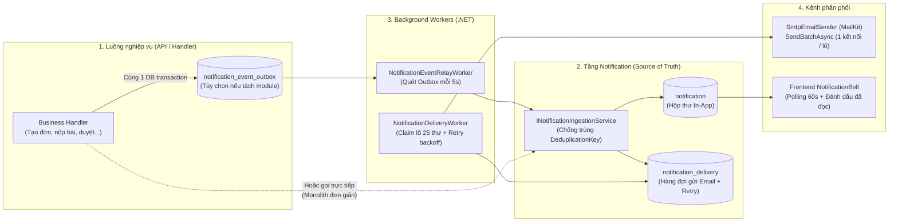

# Hướng dẫn Xây dựng Hệ thống Thông báo (SMTP Email + In-App)

Bộ tài liệu này hướng dẫn cách tái sử dụng toàn bộ kiến trúc **EmailService (SMTP)** và **In-App Notification** của dự án UGTM để áp dụng cho một dự án mới từ con số 0 (bao gồm cả bước tạo tài khoản mail gửi đi, thiết kế database, background worker, API và UI quả chuông trên Frontend).

> **Phạm vi tài liệu:** Chỉ tập trung vào **In-App Notification** và **SMTP Email** (đã lược bỏ hoàn toàn phần Web Push / FCM để đơn giản hóa hạ tầng).

---

## 1. Kiến trúc tổng thể (2 kênh phối hợp)

Thay vì gọi hàm gửi SMTP trực tiếp bên trong API request (gây chậm request và dễ mất mail nếu rớt mạng), hệ thống tách làm 2 tầng bất đồng bộ theo mẫu **Transactional Outbox + Delivery Queue**:

---

## 2. Những nguyên tắc cốt lõi giúp hệ thống chạy ổn định

1. **In-App là nguồn dữ liệu gốc (Source of Truth):** Mọi thông báo (dù gửi mail hay không) đều ghi vào bảng `notification`. Người dùng luôn tra cứu lại được lịch sử trên quả chuông.
2. **Không gửi SMTP đồng bộ trong HTTP Request:** API chỉ ghi vào DB rồi trả về ngay (`< 50ms`). `NotificationDeliveryWorker` sẽ gửi mail ở nền và tự động retry theo cấp số nhân (`1m → 5m → 15m → 30m → 60m`) nếu SMTP tạm thời lỗi.
3. **Chống gửi trùng bằng Database Constraint (`DeduplicationKey`):** Dùng Partial Unique Index `(recipient_id, deduplication_key) WHERE deduplication_key IS NOT NULL` để worker hoặc relay có chạy lặp lại cũng không bao giờ tạo 2 thông báo giống nhau.
4. **Gửi từng người riêng biệt, tái sử dụng kết nối (`SendBatchAsync`):** Tuyệt đối không dùng `To:` / `Bcc:` hàng loạt (tránh lộ email và bị đánh dấu spam). Mở 1 kết nối `SmtpClient`, xác thực 1 lần rồi gửi lần lượt cả lô 20–25 thư.
5. **An toàn khi chạy nhiều instance (`FOR UPDATE SKIP LOCKED`):** Câu SQL claim hàng đợi trên PostgreSQL dùng `FOR UPDATE SKIP LOCKED` để 2 worker chạy song song không bao giờ lấy trùng cùng 1 dòng.

---

## 3. Danh mục hướng dẫn chi tiết

| Phần | File | Nội dung chính |
| --- | --- | --- |
| **Phần 1** | [01-smtp-account-and-email-service.md](./01-smtp-account-and-email-service.md) | Tạo tài khoản Gmail App Password / SMTP (Dev & Prod), cấu hình `SmtpOptions` + `.env`, cài `MailKit`, viết `SmtpEmailSender.SendBatchAsync` và Template HTML/Text chuẩn tiếng Việt (chống XSS). |
| **Phần 2** | [02-database-and-inapp-notifications.md](./02-database-and-inapp-notifications.md) | Thiết kế bảng `notification`, `notification_delivery`, `notification_event_outbox`, bộ Index bắt buộc, `INotificationIngestionService` và 4 REST API cho hộp thư In-App. |
| **Phần 3** | [03-workers-and-frontend-bell.md](./03-workers-and-frontend-bell.md) | Triển khai `NotificationDeliveryWorker` (claim + retry + lease recovery), `NotificationEventRelayWorker`, giao diện React `NotificationBell` và Checklist test End-to-End. |
